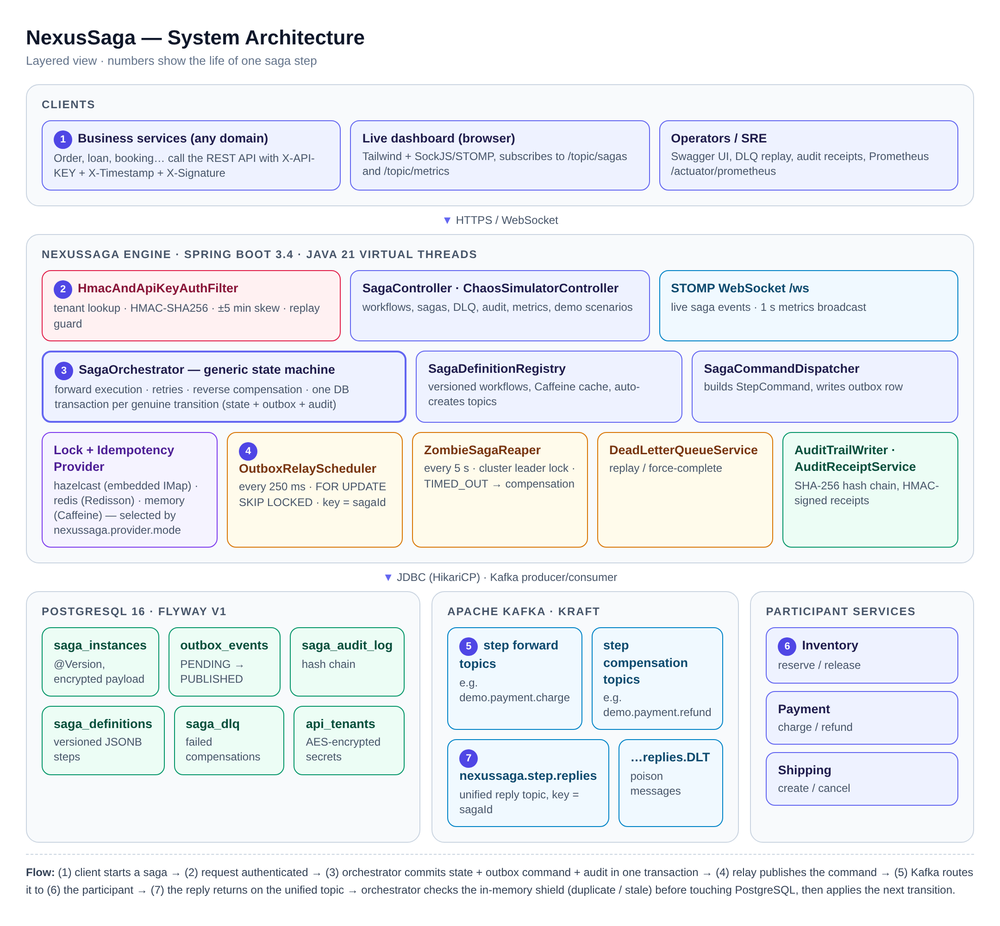

# NexusSaga: Enterprise Generic Saga Orchestration Engine

© 2026 Satyendra Singh. All Rights Reserved.

NexusSaga is a domain-agnostic, plug-and-play saga orchestrator built with **Java 21** and **Spring Boot 3.4**.
You register a workflow as JSON, start sagas over a signed REST API, and the engine drives each step over Kafka.
If a step keeps failing, the engine automatically compensates the completed steps in exact reverse order.

```
           POST /api/v1/sagas/{wf}/start  (X-API-KEY + HMAC)
                         │
                ┌────────▼─────────┐  one DB transaction   ┌──────────────┐
                │  SagaOrchestrator├──────────────────────►│ saga_instances│
                │  (state machine) │  state + outbox +     │ outbox_events │
                └──▲───────────┬───┘  hash-chained audit   │ saga_audit_log│
   idempotency +   │           │                           └──────┬───────┘
   saga snapshot   │           │                                  │ FOR UPDATE SKIP LOCKED
 ┌─────────────────┴──┐        │                          ┌───────▼────────┐
 │ Lock/Idempotency   │        │                          │OutboxRelay     │──► step.forwardTopic / compensationTopic
 │ Provider           │        │                          └────────────────┘    (key = sagaId)
 │ hazelcast|redis|mem│        │                                                       │
 └────────────────────┘        │◄──── nexussaga.step.replies (key = sagaId) ◄──────────┘ participants
                               │
                    ZombieSagaReaper (timeouts) · DeadLetterQueueService (replay / force-complete)
```


## Documentation

Full documentation with architecture and flow diagrams is in [`docs/`](docs/README.md):

| Document | PDF |
|---|---|
| Complete handbook (all parts, 54 pages) | [00_NexusSaga_Complete_Documentation.pdf](docs/pdf/00_NexusSaga_Complete_Documentation.pdf) |
| Architecture & Design | [PDF](docs/pdf/01_NexusSaga_Architecture_and_Design.pdf) · [Markdown](docs/01-architecture-and-design.md) |
| Saga Process Flows | [PDF](docs/pdf/02_NexusSaga_Saga_Process_Flows.pdf) · [Markdown](docs/02-saga-process-flows.md) |
| Security & Compliance | [PDF](docs/pdf/03_NexusSaga_Security_and_Compliance.pdf) · [Markdown](docs/03-security-and-compliance.md) |
| API & Integration Guide | [PDF](docs/pdf/04_NexusSaga_API_and_Integration_Guide.pdf) · [Markdown](docs/04-api-and-integration-guide.md) |
| Operations, Deployment & Testing | [PDF](docs/pdf/05_NexusSaga_Operations_and_Deployment.pdf) · [Markdown](docs/05-operations-and-deployment.md) |



## Quick start

```bash
docker compose up --build
```

| URL | What |
|---|---|
| http://localhost:8080 | Live dashboard (WebSocket): press the three chaos buttons |
| http://localhost:8080/swagger-ui.html | OpenAPI / Swagger UI |
| http://localhost:8081 | Kafka UI |

The dashboard needs no external services. A built-in mock participant (`ChaosStepWorker`) plays inventory, payment and shipping:

* **Run Happy Path**: all 3 steps complete, so the saga ends `COMPLETED`.
* **Step-3 Crash → Auto-Rollback**: ship-order fails on all 3 attempts. The engine compensates charge-payment, then reserve-inventory, and the saga ends `FAILED`.
* **Network Hang → Zombie Reaper**: charge-payment never replies. After 8 s the reaper records `TIMED_OUT` and compensates steps 2 and 1, so the saga ends `FAILED`.

Each row has a **Download Audit Receipt** button.

### Run locally without Docker for the app

```bash
docker compose up -d postgres kafka
mvn spring-boot:run
```

## Provider modes (`nexussaga.provider.mode`)

| Mode | Locks | Idempotency + saga snapshot | External server |
|---|---|---|---|
| `hazelcast` (default) | Embedded Hazelcast `IMap` key locks with lease | Partitioned, backed-up `IMap`s shared by all nodes | none |
| `redis` | Redisson `RLock` (watchdog lease) | `SET NX PX` buckets | Redis |
| `memory` | Striped `ReentrantLock`s | Caffeine with per-entry TTL | none (single node, or rely on Kafka `sagaId` partition ownership) |

Only the selected provider's beans are created (`@ConditionalOnProperty`). For multi-node Hazelcast, set
`HAZELCAST_MEMBERS=node1:5701,node2:5701`.

> **Note on `FencedLock`:** Hazelcast 5.5 moved the CP Subsystem behind `FencedLock` into the Enterprise edition.
> On the open-source edition it fails with *"CP subsystem is a licensed feature"*. NexusSaga therefore uses `IMap` key locks.
> They are cluster-wide and owned by the acquiring thread, and their lease (`nexussaga.provider.lock-lease`, default 30 s) releases a lock held by a crashed member.

## API

Every `/api/**` call except `/api/v1/chaos/**` needs three headers:

| Header | Value |
|---|---|
| `X-API-KEY` | tenant API key from `api_tenants` (a bootstrap tenant is created from config) |
| `X-Timestamp` | epoch **milliseconds** (seconds also accepted); must be within ±5 min |
| `X-Signature` | `hex(HMAC-SHA256(tenantSecret, X-Timestamp + "." + rawBody))` |

Each signature is accepted only once, which blocks replays. If you set `nexussaga.security.require-timestamp=false`, the string to sign becomes the raw body alone.

```bash
API_KEY=nxs_live_default_key_change_me
SECRET=change-me-nexussaga-dev-hmac-secret-0123456789
sign() { TS=$(date +%s%3N); SIG=$(printf '%s' "$TS.$1" | openssl dgst -sha256 -hmac "$SECRET" -hex | sed 's/^.* //'); }

BODY='{"workflowName":"loan-approval","steps":[
  {"stepName":"kyc","forwardTopic":"loan.kyc","compensationTopic":"loan.kyc.undo","maxRetries":1,"timeoutSeconds":30,"encryptedFields":["applicant.ssn"]},
  {"stepName":"disburse","forwardTopic":"loan.disburse","compensationTopic":"loan.disburse.undo","maxRetries":2,"timeoutSeconds":60,"encryptedFields":[]}]}'
sign "$BODY"
curl -X POST localhost:8080/api/v1/workflows -H "Content-Type: application/json" \
  -H "X-API-KEY: $API_KEY" -H "X-Timestamp: $TS" -H "X-Signature: $SIG" -d "$BODY"
```

| Method | Path | Purpose |
|---|---|---|
| POST | `/api/v1/workflows` | Register a workflow (each call creates a new immutable version) |
| GET | `/api/v1/workflows/{name}` | Latest definition |
| POST | `/api/v1/sagas/{workflowName}/start` | `{"correlationId": "...", "payload": {...}}`; starts are idempotent per correlationId |
| GET | `/api/v1/sagas/{sagaId}` | Saga state (PII masked) |
| GET | `/api/v1/sagas/{sagaId}/audit` | Download the audit receipt |
| GET | `/api/v1/dlq` | Pending DLQ entries |
| POST | `/api/v1/dlq/{sagaId}/replay` | Re-dispatch the failed compensation; reverse traversal then continues |
| POST | `/api/v1/dlq/{sagaId}/force-complete` | Close after manual remediation (saga ends `FAILED`) |
| GET | `/api/v1/metrics/db-savings` | Live shield statistics |
| POST | `/api/v1/chaos/{happy-path\|step3-crash\|zombie-hang}` | Public demo (isolated demo tenant, rate limited) |

## Participant contract

Commands arrive on the step topic with key = `sagaId`:

```json
{"messageId":"…","sagaId":"…","workflowName":"…","stepName":"kyc","stepIndex":0,"type":"FORWARD",
 "attempt":1,"payload":{…},"replyTopic":"nexussaga.step.replies","issuedAt":"…"}
```

Reply to `replyTopic` with key = `sagaId`, and echo `messageId` as `commandId`:

```json
{"messageId":"<new id>","commandId":"<command messageId>","sagaId":"…","stepName":"kyc","stepIndex":0,
 "type":"FORWARD","outcome":"SUCCESS","attempt":1,"output":{"any":"data"},"error":null}
```

* Encrypted fields arrive as `enc:v1:…` ciphertext. Participants that need the cleartext share the AES key and call `AesGcmPayloadEncryptor.decryptFields`.
* After a forward timeout, compensation starts at the hung step itself, because the participant may have acted without replying. Compensation handlers must therefore accept "nothing to undo".
* A reply to any command other than the one currently awaited is stale and ignored. Duplicate replies are absorbed.

## Design notes

* **Transactional outbox:** the state change, outbox command and audit entries commit in one transaction, and only on genuine transitions. Relays on several nodes run in parallel using `FOR UPDATE SKIP LOCKED`.
* **In-memory shield:** duplicate and stale replies are rejected through the provider before PostgreSQL is touched. `GET /api/v1/metrics/db-savings` reports `totalEventsProcessed`, `dbQueriesSavedByCache` and the savings %, plus `totalSqlStatements` counted by a Hibernate `StatementInspector`. The % is measured, not assumed. It depends on how many redeliveries and stale replies your traffic contains: the demo worker re-sends 35 % of replies (`nexussaga.demo.duplicate-reply-rate`), which shows about 20–30 %, and redelivery-heavy traffic, such as consumer-group rebalances and retries, pushes it higher.
* **Optimistic locking:** `saga_instances.version` (`@Version`) works alongside a per-saga distributed lock.
* **PII:** AES-256-GCM with a random 96-bit IV for each value. Values are masked as `****` in API responses, audit entries and receipts.
* **Audit receipts:** each entry stores `SHA-256(prevHash + canonical(entry))`. The receipt recomputes the chain, reports `chainVerified` and `firstInvalidSeq`, and is signed with HMAC-SHA256 under the server secret. Timestamps have microsecond precision.
* **Statuses:** `STARTED → IN_PROGRESS → COMPLETED`, or `→ COMPENSATING → FAILED`, or `→ COMPENSATION_FAILED_DLQ`. `TIMED_OUT` is recorded in the audit trail when the reaper fires, immediately before compensation starts.
* **Web stack:** Spring MVC on virtual threads. JPA and JDBC are blocking, so WebFlux would only add complexity.

## Tests

```bash
mvn clean verify    # 129 unit tests + Testcontainers end-to-end test (needs Docker); ~90% branch coverage
```

* Unit tests cover reverse compensation traversal, retries, DLQ, duplicate and stale shielding, timeouts, all three providers (Hazelcast runs a real embedded member), the HMAC filter, AES-GCM, audit chains, the reaper and the registry. The JaCoCo report is written to `target/site/jacoco/index.html`.
* `NexusSagaIntegrationTest` uses real PostgreSQL 16 and Kafka containers. It registers a 3-step workflow, fails step 3, and asserts the exact compensation order (step 2, then step 1), the final `FAILED` state, PII encrypted at rest, a fully relayed outbox, and a valid, signed audit receipt.
  It uses `apache/kafka:3.8.1` because Testcontainers' KRaft listener layout is rejected by Kafka 3.9+, and Testcontainers 1.21.4 because Docker Engine 29 requires a newer Docker API version than older releases send.

## CI pipeline

`.github/workflows/ci.yml` runs on every push and pull request:

| Job | What it runs |
|---|---|
| Build · unit tests · integration test | `mvn clean verify`: 129 unit tests + Testcontainers test (PostgreSQL + Kafka), JaCoCo coverage summary, jar artifact |
| Docker image · compose stack · smoke test | `docker compose up --build --wait`, then `scripts/smoke-test.sh` (19 checks: security, workflow API, all 3 chaos scenarios, audit receipt, encryption at rest, metrics) |
| Documentation PDFs | Rebuilds every PDF in `docs/pdf` from the Markdown sources |

Run the smoke test locally against a running stack: `./scripts/smoke-test.sh`.

## Configuration

| Property | Default | |
|---|---|---|
| `nexussaga.provider.mode` | `hazelcast` | `hazelcast` \| `redis` \| `memory` |
| `nexussaga.security.hmac-secret` | dev value | **change in production** |
| `nexussaga.security.aes-key` | dev value | base64 32-byte key: `openssl rand -base64 32` |
| `nexussaga.reaper.check-interval-ms` | `5000` | zombie reaper period |
| `nexussaga.kafka.reply-topic` | `nexussaga.step.replies` | unified reply topic |
| `nexussaga.kafka.partitions` | `6` | partitions for created topics |
| `nexussaga.demo.enabled` | `true` | chaos endpoints and mock participants |
