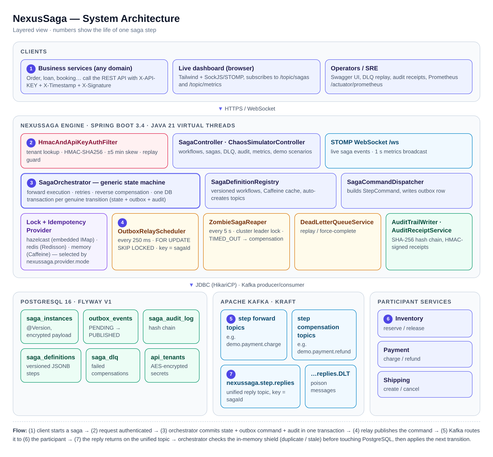
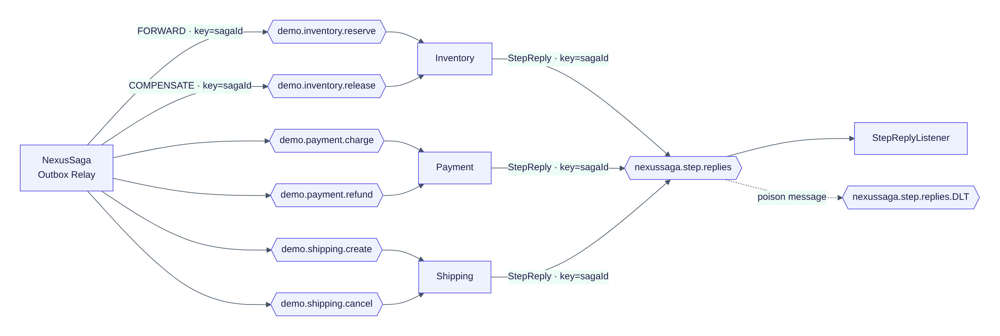
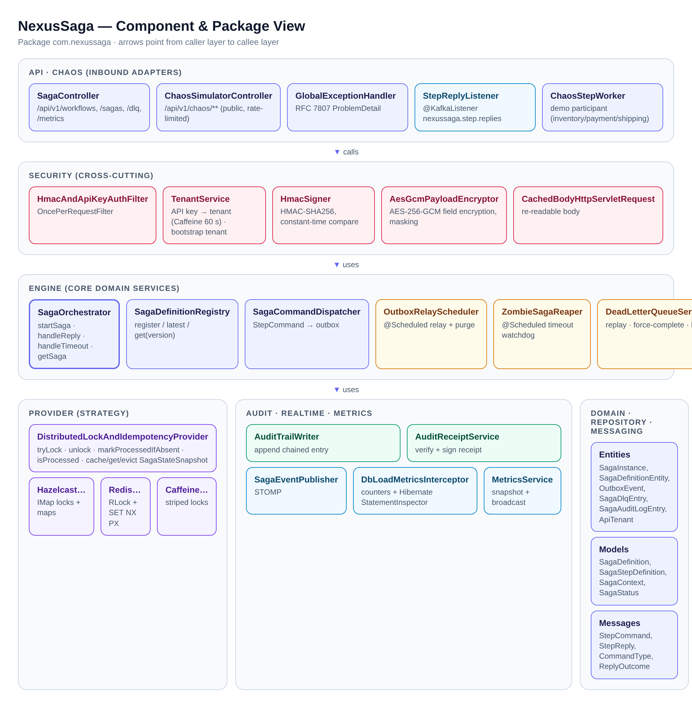
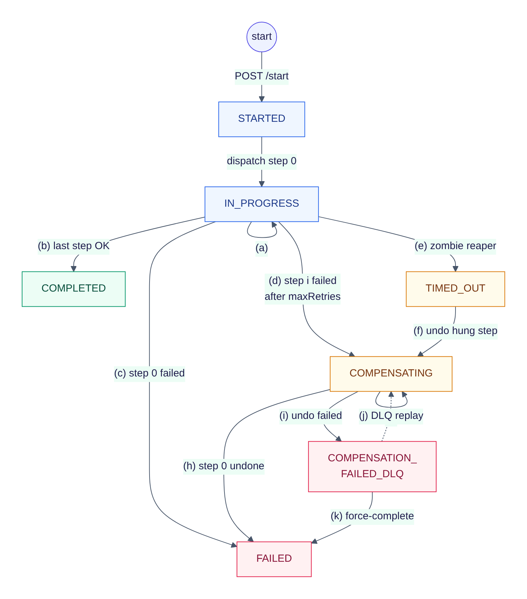
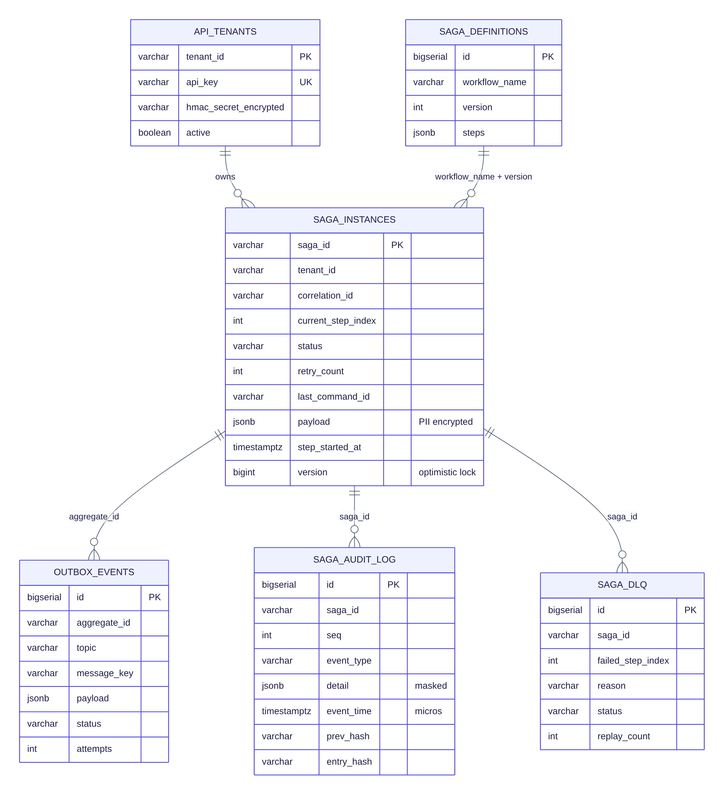
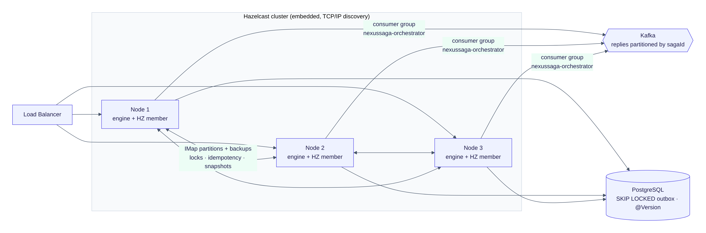
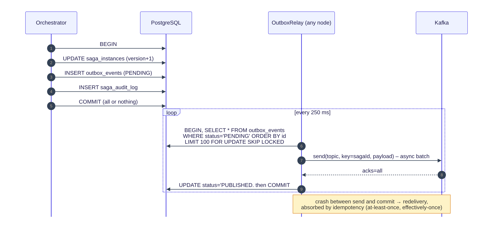
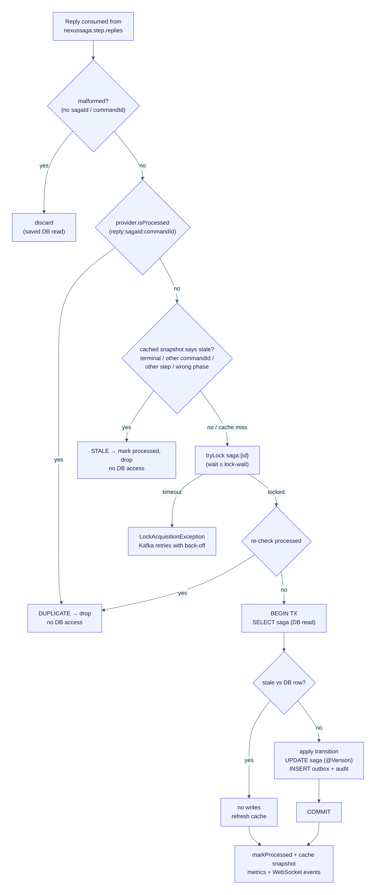

# 1. Introduction

## 1.1 Purpose

This document describes the architecture of **NexusSaga**, a domain-agnostic saga orchestration engine. It is written for architects, senior engineers and reviewers who need to understand how the engine is structured, why each design decision was taken, and which guarantees the engine gives.

## 1.2 The problem NexusSaga solves

A business process often spans several microservices, each owning its own database. For example: reserve inventory, charge payment, then create a shipment. A single ACID transaction across those services is not possible. If step 3 fails, steps 1 and 2 have already committed in other systems and must be undone with business-level compensating actions (release the stock, refund the payment).

The **Saga pattern** handles this. NexusSaga implements the *orchestration* variant: a central engine knows the workflow, sends each step a command, waits for the reply, and on failure drives the compensations in exact reverse order.

## 1.3 Goals

| # | Goal | How NexusSaga achieves it |
|---|---|---|
| G1 | Domain-agnostic | Workflows are registered as JSON at runtime; payloads are arbitrary JSON |
| G2 | Reliable delivery | Transactional outbox: state change and outgoing command commit together |
| G3 | Exactly-once effect | Per-command idempotency keys + stale-reply detection + optimistic locking |
| G4 | Automatic recovery | Retries, reverse compensation, zombie reaper, dead letter queue |
| G5 | Low database load | In-memory shield (Hazelcast / Redis / Caffeine) rejects duplicates before PostgreSQL |
| G6 | Zero-trust security | HMAC request signing, replay protection, AES-256-GCM PII encryption |
| G7 | Auditability | SHA-256 hash-chained audit log, HMAC-signed downloadable receipts |
| G8 | Horizontal scale | Stateless nodes, Kafka partitioning by `sagaId`, `SKIP LOCKED` outbox relay |

## 1.4 Technology stack

| Concern | Technology |
|---|---|
| Language / runtime | Java 21 (virtual threads enabled) |
| Framework | Spring Boot 3.4 (Web MVC, Data JPA, Security, Kafka, WebSocket, Actuator) |
| Database | PostgreSQL 16, schema managed by Flyway |
| Messaging | Apache Kafka (KRaft mode, no ZooKeeper) |
| Distributed state | Embedded Hazelcast 5.5 (default), Redisson/Redis, or Caffeine |
| API docs | SpringDoc OpenAPI / Swagger UI |
| Observability | Micrometer + Prometheus, live STOMP dashboard |
| Tests | JUnit 5, Mockito, Testcontainers (PostgreSQL + Kafka), JaCoCo |

# 2. Architecture overview

## 2.1 System architecture

The engine is a single deployable Spring Boot service. Clients call its REST API; the engine talks to participants **only through Kafka**, never synchronously. This keeps participants decoupled: a participant only needs to consume commands from its topics and publish replies to one shared reply topic.

## 2.2 Life of one saga step

1. A client calls `POST /api/v1/sagas/{workflow}/start` with a signed request.
2. `HmacAndApiKeyAuthFilter` authenticates the tenant and verifies the signature.
3. `SagaOrchestrator` creates the saga and, **in one database transaction**, writes the saga row, the outbox command for step 0 and the audit entries.
4. `OutboxRelayScheduler` publishes the command to the step's forward topic, keyed by `sagaId`.
5. The participant service executes the step.
6. It publishes a `StepReply` to `nexussaga.step.replies`.
7. The orchestrator checks the in-memory shield (duplicate? stale?), then applies the next transition.

## 2.3 End-to-end Kafka topology

Every message on every topic is keyed by `sagaId`. Kafka's default partitioner therefore places all messages of one saga on the same partition, which gives per-saga ordering and lets exactly one consumer at a time process a saga's replies.

# 3. Component design

## 3.1 Components and responsibilities

| Component | Package | Responsibility |
|---|---|---|
| `SagaController` | api | Tenant-facing REST API: workflows, sagas, DLQ, audit, metrics |
| `ChaosSimulatorController` | chaos | Public demo endpoints, isolated demo tenant, rate-limited |
| `HmacAndApiKeyAuthFilter` | security | API-key lookup, HMAC verification, timestamp window, replay guard |
| `TenantService` | security | Resolves API keys (cached 60 s), seeds the bootstrap tenant |
| `AesGcmPayloadEncryptor` | security | Field-level AES-256-GCM encryption and `****` masking |
| `SagaOrchestrator` | engine | The generic state machine: start, reply handling, timeouts, queries |
| `SagaDefinitionRegistry` | engine | Versioned workflow registration, validation, Caffeine cache, topic creation |
| `SagaCommandDispatcher` | engine | Builds a `StepCommand` and writes it to the outbox |
| `OutboxRelayScheduler` | engine | Publishes pending outbox rows to Kafka (`SKIP LOCKED`), purges old rows |
| `ZombieSagaReaper` | engine | Detects steps that exceeded `timeoutSeconds` |
| `DeadLetterQueueService` | engine | Replay or force-complete sagas whose compensation failed |
| `DistributedLockAndIdempotencyProvider` | provider | Strategy interface: locks, idempotency keys, saga snapshots |
| `AuditTrailWriter` / `AuditReceiptService` | audit | Hash-chained audit log, signed receipts |
| `StepReplyListener` | messaging | Kafka consumer for the unified reply topic |
| `SagaEventPublisher` / `MetricsService` | realtime / metrics | STOMP live events and metrics broadcast |
| `DbLoadMetricsInterceptor` | metrics | Atomic counters + Hibernate `StatementInspector` |
| `ChaosStepWorker` | chaos | In-process mock of the inventory, payment and shipping services |

# 4. The saga state machine

| Label | Transition | Trigger |
|---|---|---|
| (a) | IN_PROGRESS → IN_PROGRESS | Step *i* succeeded and step *i+1* is dispatched, **or** step *i* failed with retries left and is re-dispatched |
| (b) | IN_PROGRESS → COMPLETED | Last step succeeded |
| (c) | IN_PROGRESS → FAILED | Step 0 failed after its retries; nothing to compensate |
| (d) | IN_PROGRESS → COMPENSATING | Step *i* failed after `maxRetries`; compensation starts at *i − 1* |
| (e) | IN_PROGRESS → TIMED_OUT | Zombie reaper: no reply within `timeoutSeconds` |
| (f) | TIMED_OUT → COMPENSATING | Compensation starts at the hung step *i* itself (it may have acted without replying) |
| (g) | COMPENSATING → COMPENSATING | Undo of step *i* succeeded → undo *i − 1*, **or** undo failed/timed out with retries left |
| (h) | COMPENSATING → FAILED | Step 0 has been compensated: fully rolled back |
| (i) | COMPENSATING → COMPENSATION_FAILED_DLQ | An undo failed after `maxRetries` |
| (j) | DLQ → COMPENSATING | Operator replay |
| (k) | DLQ → FAILED | Operator force-complete after manual remediation |

**Terminal states:** `COMPLETED`, `FAILED`, `COMPENSATION_FAILED_DLQ`. `TIMED_OUT` is transitional: it is recorded in the audit trail and immediately followed by `COMPENSATING` in the same transaction.

## 4.1 The "one expected command" rule

Every dispatched command gets a fresh UUID (`messageId`), stored in `saga_instances.last_command_id`. A participant must echo it as `commandId`. A reply is processed **only** if it answers the command the saga is currently waiting for. Any other reply (late, duplicated, from a superseded retry, or for the wrong phase) is *stale* and ignored. This single rule makes retries, timeouts and DLQ replays safe without complex bookkeeping.

# 5. Data model

| Table | Purpose | Key indexes |
|---|---|---|
| `api_tenants` | API clients; HMAC secret stored AES-encrypted | `uq(api_key)`, `(api_key, active)` |
| `saga_definitions` | Immutable, versioned workflows (`steps` JSONB) | `uq(workflow_name, version)`, `(workflow_name, version DESC)` |
| `saga_instances` | Saga state; `version` column backs `@Version` optimistic locking | `(status, step_started_at)` for the reaper; `uq(tenant_id, workflow_name, correlation_id)` for idempotent starts |
| `outbox_events` | Commands waiting to be published | `(status, id)` for the relay; `(aggregate_id, created_at)` |
| `saga_dlq` | Sagas whose compensation failed | `(saga_id, status)`, `(tenant_id, status, created_at DESC)` |
| `saga_audit_log` | Hash-chained audit trail | `uq(saga_id, seq)` |

All timestamps are `TIMESTAMPTZ(6)` (microsecond precision). The schema is created by `V1__init_nexussaga.sql`; Hibernate runs with `ddl-auto: validate`, so the application refuses to start if code and schema drift apart.

# 6. Pluggable lock and idempotency providers

The `DistributedLockAndIdempotencyProvider` interface hides *where* locks, idempotency keys and saga snapshots live. Exactly one implementation is loaded, selected by `nexussaga.provider.mode` through `@ConditionalOnProperty`.

| Mode | Locks | Idempotency + snapshots | External server | Best for |
|---|---|---|---|---|
| `hazelcast` (default) | `IMap.tryLock` with lease | Partitioned, backed-up `IMap`s | None (embedded) | Multi-node clusters without extra infrastructure |
| `redis` | Redisson `RLock` (watchdog) | `SET NX PX` buckets | Redis | Teams that already run Redis |
| `memory` | Striped `ReentrantLock`s | Caffeine, per-entry TTL | None | Single node, or when Kafka partition ownership is enough |

**Why not Hazelcast `FencedLock`?** Since Hazelcast 5.5 the CP Subsystem behind `FencedLock` is an Enterprise feature; on the open-source edition it fails with *"CP subsystem is a licensed feature"*. NexusSaga uses `IMap` key locks instead. They are cluster-wide, owned by the acquiring thread, and carry a lease (`nexussaga.provider.lock-lease`, default 30 s), so a lock held by a crashed member is released automatically.

**Lock striping.** The Redis and memory providers map lock keys onto a bounded number of stripes (`lock-stripes`, default 256), so the number of lock objects never grows with the number of sagas.

# 7. Reliability mechanisms

## 7.1 Transactional outbox

Publishing to Kafka directly inside a database transaction is unsafe: the transaction can roll back after the message was sent, or commit before a crash prevents the send. NexusSaga writes the command into `outbox_events` **inside the same transaction** as the state change. A separate relay publishes committed rows.

- Rows are claimed with `FOR UPDATE SKIP LOCKED`, so any number of nodes can relay in parallel without publishing the same row twice.
- The producer uses `acks=all` and `enable.idempotence=true`.
- A crash between send and commit leads to a redelivery, which the idempotency layer absorbs. The result is *at-least-once delivery with exactly-once effect*.
- Failed sends are retried up to `outbox.max-attempts` (default 10) before the row is marked `FAILED`. Published rows older than 7 days are purged hourly.

## 7.2 Reply processing and the in-memory shield

Before touching PostgreSQL, every reply passes three cheap checks against the active provider:

1. **Malformed?** Missing `sagaId` or `commandId` → discarded.
2. **Duplicate?** `isProcessed("reply:{sagaId}:{commandId}")` → dropped with no DB access.
3. **Stale?** The cached `SagaStateSnapshot` shows the saga is terminal, waits for a different command, is on another step, or is in the other phase → dropped with no DB access.

Only replies that pass all three acquire the per-saga lock and read the database. After commit, the reply key is marked processed and the snapshot is refreshed.

## 7.3 Concurrency control

Three layers protect a saga against concurrent modification:

| Layer | Mechanism | Protects against |
|---|---|---|
| Kafka | Partitioning by `sagaId` | Two consumers processing the same saga in parallel (normal operation) |
| Provider | Per-saga distributed lock | Overlap during consumer rebalances, reaper vs. reply races |
| Database | `@Version` optimistic locking | Any remaining lost-update race; the loser retries via Kafka back-off |

## 7.4 Timeouts and the zombie reaper

Every 5 seconds (`reaper.check-interval-ms`) one node, holding the cluster-wide leader lock, scans for sagas in `IN_PROGRESS`, `COMPENSATING` or `TIMED_OUT` whose `step_started_at` is older than one second. Each candidate is re-validated under its own lock against the step's real `timeoutSeconds`.

- A hung **forward** step → `TIMED_OUT` (audited) → compensation starting at the hung step.
- A hung **compensation** → retried up to `maxRetries`, then dead-lettered.

## 7.5 Dead letter queue

When a compensation fails after all retries the saga cannot heal itself, because the system is in an inconsistent state that needs a human decision. The saga moves to `COMPENSATION_FAILED_DLQ` and a `saga_dlq` row is created with an encrypted payload snapshot. Operators can **replay** (re-dispatch the failed compensation; reverse traversal then continues automatically) or **force-complete** (confirm manual remediation; the saga closes as `FAILED`).

# 8. Scalability and performance

- **Stateless engine nodes:** all state lives in PostgreSQL and the provider; add nodes behind a load balancer.
- **Parallelism:** Kafka partitions (default 6) bound the number of reply consumers; the outbox relay scales with `SKIP LOCKED`.
- **Database load:** one transaction per genuine transition; duplicates and stale replies cost zero queries. Definitions are cached (immutable per version).
- **Virtual threads:** request handling and blocking JDBC calls run on Java 21 virtual threads.
- **Measured savings:** `GET /api/v1/metrics/db-savings` reports `totalEventsProcessed`, `dbQueriesSavedByCache`, the savings percentage and `totalSqlStatements` (counted by a Hibernate `StatementInspector`). The percentage is measured, not assumed; it grows with the share of redelivered and stale replies in real traffic.

# 9. Key design decisions

| ID | Decision | Rationale | Trade-off |
|---|---|---|---|
| ADR-1 | Orchestration instead of choreography | Workflow is explicit, versioned and observable in one place; compensation order is guaranteed | The engine is a central component that must be highly available |
| ADR-2 | Kafka-only communication with participants | Decoupling, buffering, replay, natural back-pressure | Participants must be Kafka clients |
| ADR-3 | Transactional outbox | No lost or phantom commands | Small publishing delay (poll interval) |
| ADR-4 | Single expected `commandId` per saga | Makes retries, timeouts and replays idempotent with one comparison | Participants must echo `commandId` |
| ADR-5 | Compensate the hung step after a timeout | The participant may have applied the change without replying | Compensation handlers must tolerate "nothing to undo" |
| ADR-6 | Spring MVC instead of WebFlux | JPA/JDBC are blocking; virtual threads provide the concurrency | No reactive back-pressure on HTTP |
| ADR-7 | Hazelcast `IMap` locks instead of `FencedLock` | `FencedLock` needs an Enterprise licence since 5.5 | No fencing tokens; mitigated by `@Version` |
| ADR-8 | Immutable versioned workflow definitions | Running sagas are never affected by re-registration | Old versions remain stored |
| ADR-9 | Hash-chained audit with canonical JSON | Tamper evidence independent of PostgreSQL `jsonb` key ordering | Hash must be recomputed over a canonical form |

# 10. Known limitations

- Steps run strictly sequentially; parallel branches within one saga are not supported.
- Live dashboard events are pushed by the node that processed the transition; in a multi-node deployment a browser sees the events of the node it is connected to (metrics and DB state are always global).
- The public chaos endpoints are intended for demos and should be disabled in production (`nexussaga.demo.enabled=false`).
