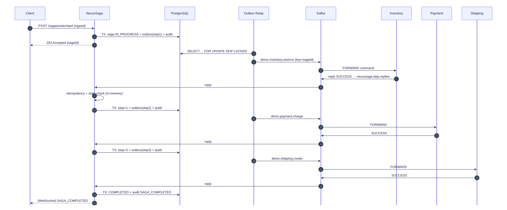
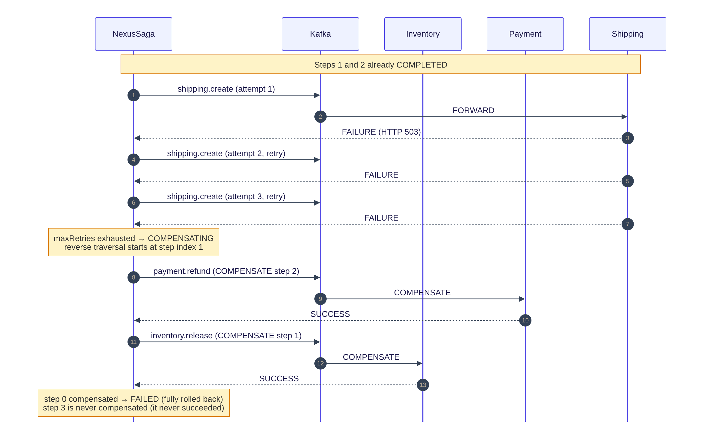
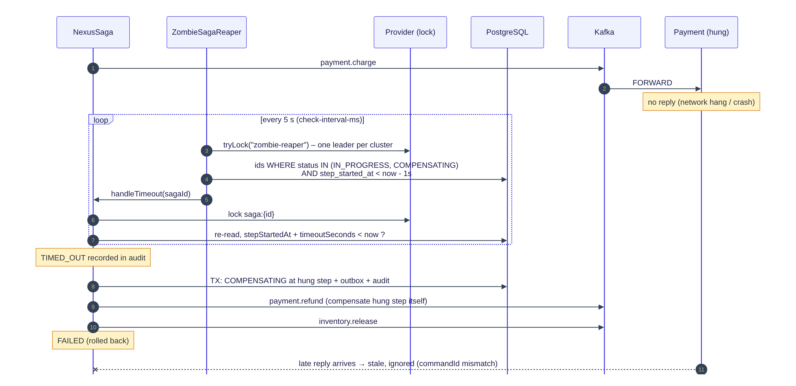
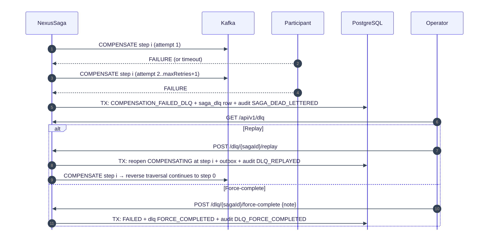

# 1. Overview

This document walks through every path a saga can take. Each scenario shows the sequence of messages, the state transitions, and the audit trail the engine writes. The examples use the built-in demo workflow:

| Index | Step | Forward topic | Compensation topic | maxRetries | timeoutSeconds | Encrypted fields |
|---|---|---|---|---|---|---|
| 0 | `reserve-inventory` | `demo.inventory.reserve` | `demo.inventory.release` | 1 | 10 | — |
| 1 | `charge-payment` | `demo.payment.charge` | `demo.payment.refund` | 1 | 8 | `customer.cardNumber`, `customer.email` |
| 2 | `ship-order` | `demo.shipping.create` | `demo.shipping.cancel` | 2 | 10 | `customer.address` |

**Terminology**

- **Forward command:** asks a participant to perform a step (`type = FORWARD`).
- **Compensating command:** asks a participant to undo a step it completed earlier (`type = COMPENSATE`).
- **Attempt:** 1 for the first try, then 2, 3… for retries. A step runs at most `maxRetries + 1` times.
- **Reply:** a `StepReply` with `outcome = SUCCESS | FAILURE` on `nexussaga.step.replies`.

# 2. Flow 1: Happy path

| # | What happens | Status after | DB writes (one transaction) |
|---|---|---|---|
| 1 | Client starts the saga | `IN_PROGRESS`, step 0 | saga row, outbox(reserve), audit `SAGA_STARTED`, `STEP_DISPATCHED` |
| 2 | Inventory replies SUCCESS | `IN_PROGRESS`, step 1 | saga update, outbox(charge), audit `STEP_COMPLETED`, `STEP_DISPATCHED` |
| 3 | Payment replies SUCCESS | `IN_PROGRESS`, step 2 | saga update, outbox(ship), audit ×2 |
| 4 | Shipping replies SUCCESS | `COMPLETED` | saga update, audit `STEP_COMPLETED`, `SAGA_COMPLETED` |

Each step's `output` (for example `{"trackingNumber": "TRK-…"}`) is merged into the saga context under `stepOutputs.<stepName>`, so later steps can use it.

**Audit trail (8 entries):**

| seq | eventType | step | status |
|---|---|---|---|
| 1 | SAGA_STARTED | reserve-inventory | STARTED |
| 2 | STEP_DISPATCHED | reserve-inventory | IN_PROGRESS |
| 3 | STEP_COMPLETED | reserve-inventory | IN_PROGRESS |
| 4 | STEP_DISPATCHED | charge-payment | IN_PROGRESS |
| 5 | STEP_COMPLETED | charge-payment | IN_PROGRESS |
| 6 | STEP_DISPATCHED | ship-order | IN_PROGRESS |
| 7 | STEP_COMPLETED | ship-order | IN_PROGRESS |
| 8 | SAGA_COMPLETED | ship-order | COMPLETED |

# 3. Flow 2: Step failure with retries and reverse compensation

`ship-order` has `maxRetries = 2`, so it is attempted three times. When the third attempt fails, the engine:

1. Sets the status to `COMPENSATING` and records the failure reason.
2. Starts the reverse traversal at index **1** (`charge-payment`), because step 2 never succeeded and has nothing to undo.
3. After `charge-payment` is refunded, it compensates index 0 (`reserve-inventory`).
4. When index 0 is compensated, the saga ends as `FAILED` (fully rolled back).

**Audit trail (17 entries, recorded from a real run):**

| seq | eventType | step | status |
|---|---|---|---|
| 1–6 | SAGA_STARTED … STEP_DISPATCHED (as in the happy path) | | |
| 7 | STEP_FAILED | ship-order | IN_PROGRESS |
| 8 | STEP_RETRY_DISPATCHED | ship-order | IN_PROGRESS |
| 9 | STEP_FAILED | ship-order | IN_PROGRESS |
| 10 | STEP_RETRY_DISPATCHED | ship-order | IN_PROGRESS |
| 11 | STEP_FAILED | ship-order | IN_PROGRESS |
| 12 | COMPENSATION_STARTED | charge-payment | COMPENSATING |
| 13 | COMPENSATION_DISPATCHED | charge-payment | COMPENSATING |
| 14 | STEP_COMPENSATED | charge-payment | COMPENSATING |
| 15 | COMPENSATION_DISPATCHED | reserve-inventory | COMPENSATING |
| 16 | STEP_COMPENSATED | reserve-inventory | COMPENSATING |
| 17 | SAGA_FAILED | reserve-inventory | FAILED |

The failure reason stored on the saga reads: *Step 'ship-order' failed after 3 attempt(s): Carrier API returned HTTP 503*.

**Edge case: failure at step 0.** If the very first step fails after its retries, nothing has been completed, so the saga goes straight to `FAILED` without sending any compensating command.

# 4. Flow 3: Network hang and the zombie reaper

The payment service receives the command but never replies. Without a watchdog the saga would wait forever.

1. Every 5 s the reaper (one leader node per cluster) looks for sagas whose current step started more than 1 s ago.
2. For each candidate it takes the saga lock and checks `stepStartedAt + timeoutSeconds < now`.
3. The saga is marked `TIMED_OUT` in the audit trail.
4. Compensation starts at **the hung step itself** (`charge-payment`), because the payment may have been taken even though no reply arrived. Then `reserve-inventory` is compensated.
5. The saga ends as `FAILED`.

If the late reply from payment arrives afterwards, its `commandId` no longer matches the command the saga is waiting for. It is classified as stale and ignored.

> **Participant contract:** because of step 4, compensation handlers must be idempotent and must treat "nothing to undo" as success.

# 5. Flow 4: Compensation failure and the dead letter queue

## 5.1 Real example: `loan-approval` (recorded run)

A one-step workflow `loan-approval` (step `kyc`, `maxRetries = 1`, `timeoutSeconds = 20`) was registered while no service was consuming `loan.kyc`. The engine produced this audit trail:

| seq | Time (UTC) | eventType | status | Meaning |
|---|---|---|---|---|
| 1 | 16:42:01.705435 | SAGA_STARTED | STARTED | Saga created; `pan` stored encrypted, shown as `****` |
| 2 | 16:42:01.705435 | STEP_DISPATCHED | IN_PROGRESS | `kyc` command published to `loan.kyc` |
| 3 | 16:42:24.051680 | STEP_TIMED_OUT | TIMED_OUT | No reply within 20 s; zombie reaper intervened |
| 4 | 16:42:24.051680 | COMPENSATION_STARTED | COMPENSATING | Reverse rollback starts at the hung step |
| 5 | 16:42:24.051680 | COMPENSATION_DISPATCHED | COMPENSATING | Undo command published to `loan.kyc.undo` |
| 6 | 16:42:44.106442 | COMPENSATION_TIMED_OUT | COMPENSATING | Undo also unanswered |
| 7 | 16:42:44.106442 | COMPENSATION_RETRY_DISPATCHED | COMPENSATING | Attempt 2 (`maxRetries = 1`) |
| 8 | ≈16:43:04 | SAGA_DEAD_LETTERED | COMPENSATION_FAILED_DLQ | Retries exhausted, so a human decision is needed |

The receipt reported `"chainVerified": true`: every `prevHash` matched the previous `entryHash`.

## 5.2 Operator actions

| Action | Endpoint | Effect |
|---|---|---|
| Inspect | `GET /api/v1/dlq` | Lists pending entries (never exposes the payload) |
| Replay | `POST /api/v1/dlq/{sagaId}/replay` | Saga reopened as `COMPENSATING` at the failed step; a fresh compensating command is dispatched; reverse traversal continues down to step 0. Audit: `DLQ_REPLAYED` |
| Force-complete | `POST /api/v1/dlq/{sagaId}/force-complete` with `{"note": "…"}` | Operator confirms manual remediation; saga closes as `FAILED`; the note is stored in the failure reason. Audit: `DLQ_FORCE_COMPLETED` |

# 6. Flow 5: Duplicate and stale replies

Kafka delivers messages *at least once*. Consumer rebalances, producer retries and participant restarts can all redeliver a reply. The demo worker deliberately re-sends 35 % of replies to reproduce this.

| Situation | Detected by | Database access | Result |
|---|---|---|---|
| Same reply delivered twice | `isProcessed(reply:sagaId:commandId)` in the provider | none | dropped, counted as *duplicate* |
| Reply to a superseded retry | snapshot `lastCommandId` ≠ `commandId` | none (cache hit) | dropped, counted as *saved* |
| Reply after saga finished | snapshot status is terminal | none (cache hit) | dropped |
| Cache cold (e.g. node restart) | re-checked against the DB row inside the lock | 1 read, no writes | dropped |
| Two copies racing on two nodes | per-saga lock + re-check after lock | at most 1 read | exactly one applies |

# 7. Flow 6: Idempotent saga start

`POST /api/v1/sagas/{workflow}/start` accepts an optional `correlationId` (your business key, e.g. an order number). The pair *(tenant, workflow, correlationId)* is unique:

- A repeated start with the same `correlationId` returns the **existing** saga instead of creating a second one.
- If two requests race, the database unique constraint picks one winner and the loser returns the winner's saga.
- Without a `correlationId`, a random UUID is generated.

# 8. Flow 7: Workflow registration and versioning

1. `POST /api/v1/workflows` validates the definition: name format, at least one step, unique step names, topics different from the reply topic, valid encrypted-field paths, and at most 100 steps.
2. The definition is stored as a **new immutable version** (`version = latest + 1`).
3. The engine creates the forward and compensation topics in Kafka (`partitions = 6` by default).
4. New sagas use the latest version; sagas already running keep the version they started with.

# 9. Event reference

| Event type | Written when |
|---|---|
| `SAGA_STARTED` | A saga is created (payload stored masked in the audit detail) |
| `STEP_DISPATCHED` | A forward command is queued for a step |
| `STEP_COMPLETED` | A forward reply reported SUCCESS (masked output in detail) |
| `STEP_FAILED` | A forward reply reported FAILURE |
| `STEP_RETRY_DISPATCHED` | A failed step is retried |
| `STEP_TIMED_OUT` | The zombie reaper detected a hung forward step |
| `COMPENSATION_STARTED` | Reverse traversal begins |
| `COMPENSATION_DISPATCHED` | A compensating command is queued |
| `STEP_COMPENSATED` | A compensating reply reported SUCCESS |
| `COMPENSATION_STEP_FAILED` | A compensating reply reported FAILURE |
| `COMPENSATION_TIMED_OUT` | A compensating command went unanswered |
| `COMPENSATION_RETRY_DISPATCHED` | A compensation is retried |
| `SAGA_COMPLETED` | All steps succeeded |
| `SAGA_FAILED` | Rolled back completely, or failed with nothing to compensate |
| `SAGA_DEAD_LETTERED` | Compensation failed after all retries |
| `DLQ_REPLAYED` / `DLQ_FORCE_COMPLETED` | Operator action on a dead-lettered saga |
