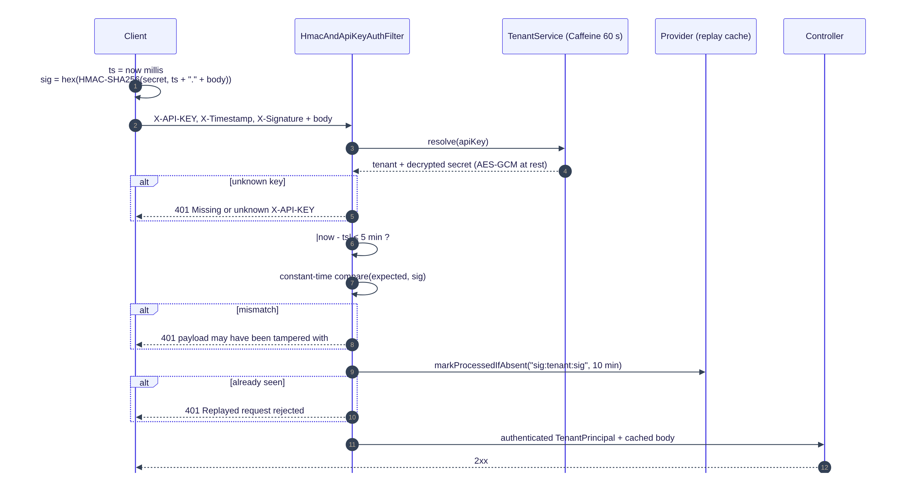
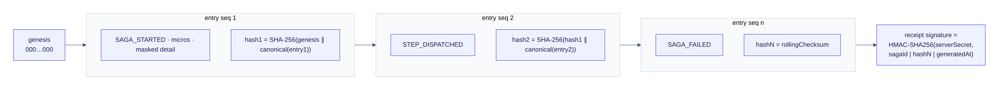

# 1. Security model

NexusSaga follows a zero-trust approach: every API request is authenticated and integrity-checked, sensitive payload fields are encrypted before they reach PostgreSQL or Kafka, and every state change is recorded in a tamper-evident audit trail.

| Layer | Control | Implementation |
|---|---|---|
| Transport | TLS (terminate at ingress / load balancer) | Deployment concern |
| Authentication | Per-tenant API key | `X-API-KEY` → `api_tenants` |
| Integrity | HMAC-SHA256 request signature | `X-Signature` over `X-Timestamp + "." + body` |
| Freshness | Timestamp window ±5 min | `X-Timestamp` (epoch ms or s) |
| Replay protection | Each signature accepted once | Provider idempotency cache, TTL 2 × skew |
| Authorization | Tenant isolation | Sagas, DLQ entries and receipts are checked against the caller's tenant |
| Confidentiality at rest | AES-256-GCM field encryption | `AesGcmPayloadEncryptor` |
| Confidentiality in output | Masking `****` | API responses, audit entries, receipts, logs |
| Auditability | SHA-256 hash chain + HMAC-signed receipt | `AuditTrailWriter`, `AuditReceiptService` |
| Secrets at rest | Tenant HMAC secrets AES-encrypted | `api_tenants.hmac_secret_encrypted` |

# 2. Request authentication (`HmacAndApiKeyAuthFilter`)



## 2.1 Signing algorithm

```text
timestamp    = current time in epoch milliseconds   (seconds also accepted)
stringToSign = timestamp + "." + rawRequestBody      (empty body → timestamp + ".")
signature    = lowercase hex( HMAC-SHA256( tenantSecret, stringToSign ) )

Headers:  X-API-KEY: <api key>
          X-Timestamp: <timestamp>
          X-Signature: <signature>        ("sha256=" prefix optional)
```

## 2.2 Verification order and responses

| Check | Failure response |
|---|---|
| API key present and belongs to an active tenant | `401 Missing or unknown X-API-KEY` |
| Body ≤ 1 MiB | `413 Request body exceeds 1 MiB` |
| `X-Signature` present | `401 Missing X-Signature` |
| `X-Timestamp` present, numeric, within ±5 min | `401 Missing or expired X-Timestamp` |
| Signature matches (constant-time comparison) | `401 Invalid X-Signature: payload may have been tampered with` |
| Signature not seen before | `401 Replayed request rejected` |

Signatures are compared with `MessageDigest.isEqual` to prevent timing attacks. The filter buffers the body once (`CachedBodyHttpServletRequest`), so the controller reads exactly the bytes that were verified.

**Body-only mode.** Setting `nexussaga.security.require-timestamp=false` switches to signing the raw body only. This is simpler for clients but gives no replay protection. Keep the default in production.

## 2.3 Public paths

These paths bypass the filter: `/`, `/index.html`, `/ws/**`, `/swagger-ui/**`, `/v3/api-docs/**`, `/api/v1/chaos/**`, `/actuator/health/**`, `/actuator/info`, `/actuator/prometheus`. Every other path is denied unless authenticated.

> In production, disable the demo (`nexussaga.demo.enabled=false`) and expose `/actuator/prometheus` only on an internal network.

## 2.4 Tenants

The table `api_tenants` holds one row per client: `tenant_id`, `api_key`, and the HMAC secret **encrypted with AES-256-GCM**. Resolved tenants are cached in memory for 60 seconds. On first start the engine creates a bootstrap tenant from `nexussaga.security.bootstrap-tenant.*` using `nexussaga.security.hmac-secret`.

# 3. PII protection (`AesGcmPayloadEncryptor`)

## 3.1 Configuration

Each workflow step lists the JSON paths to protect:

```json
{ "stepName": "charge-payment", "encryptedFields": ["customer.cardNumber", "customer.email"] }
```

The union of all steps' `encryptedFields` is applied to the whole saga payload when the saga starts and whenever a step's output is merged.

## 3.2 Algorithm

| Property | Value |
|---|---|
| Cipher | AES-256 in GCM mode (authenticated encryption) |
| Key | 32 bytes, base64 in `nexussaga.security.aes-key` |
| IV | 96 bits, random per value (`SecureRandom`) |
| Tag | 128 bits |
| Text format | `enc:v1:` + base64(IV ‖ ciphertext ‖ tag) |
| Non-text JSON | `enc:v1j:` prefix; restored to the original JSON type on decryption |

Because the IV is random, encrypting the same value twice gives different ciphertexts, so equal values cannot be correlated. Any modification of the ciphertext makes decryption fail (the GCM tag check).

**Verified in a live run:**

```text
email      : enc:v1:aoudHC8ndjITsQW/Wux4nBSNz2ZZ06WkxqbrsgrD6Mg58BM9PPmHF…
cardNumber : enc:v1:yuNOTxxLZoc+kPb51IBlD4WQ6VPBjCNW974VHW8xx6Zp+31uQDEJ…
```

## 3.3 Where data is encrypted or masked

| Location | Representation |
|---|---|
| `saga_instances.payload`, `outbox_events.payload`, `saga_dlq.payload_snapshot` | Encrypted |
| Kafka commands | Encrypted (participants that need clear text share the key and call `decryptFields`) |
| REST responses (`SagaContext.payload`) | Masked `****` |
| Audit log `detail`, audit receipts | Masked `****` |
| Application logs | Never contain payload values |

# 4. Tamper-evident audit trail



## 4.1 How the chain is built

For every audit entry, inside the same transaction as the state change:

```text
canonicalDetail = JSON with keys sorted recursively, no whitespace
material        = prevHash \n sagaId \n seq \n eventType \n stepIndex \n stepName \n status
                  \n epochMicros \n canonicalDetail
entryHash       = hex( SHA-256( material ) )
prevHash(seq 1) = 64 × "0"   (genesis)
```

Canonical JSON matters because PostgreSQL `jsonb` re-orders keys. Without it the hash recomputed from stored data would never match the original.

## 4.2 Receipt verification

`GET /api/v1/sagas/{sagaId}/audit` recomputes the whole chain from the stored fields:

| Receipt field | Meaning |
|---|---|
| `entries[].linkValid` | This entry's `seq`, `prevHash` and `entryHash` match the recomputed values |
| `integrity.chainVerified` | All links valid and at least one entry exists |
| `integrity.firstInvalidSeq` | The first broken link, if any |
| `integrity.rollingChecksum` | Hash of the last entry; it fingerprints the entire history |
| `signature.value` | `HMAC-SHA256(serverSecret, sagaId \| rollingChecksum \| generatedAt)` |

**What tampering is detected:**

| Attack | Detected by |
|---|---|
| Change any field of an entry | Recomputed hash ≠ stored `entryHash` |
| Delete an entry | `seq` gap and `prevHash` mismatch |
| Re-order entries | `prevHash` mismatch |
| Re-hash the whole chain after editing | Receipt signature no longer matches the server's HMAC |
| Edit a downloaded receipt | `AuditReceiptService.verifySignature` fails |

**Try it:** change one row with `UPDATE saga_audit_log SET detail='{"hacked":true}' WHERE id = …`. The next receipt for that saga reports `"chainVerified": false` and the exact `firstInvalidSeq`.

# 5. Threat model summary

| Threat | Mitigation | Residual risk |
|---|---|---|
| Stolen API key | Useless without the HMAC secret | Rotate secret and key together |
| Request tampering in transit | HMAC over body | None while the secret is safe |
| Replay of a captured request | Timestamp window + one-time signature cache | None within the cache TTL |
| Cross-tenant data access | Tenant checks on saga, DLQ and audit endpoints | — |
| Database dump / backup leak | PII and tenant secrets encrypted | Key must be stored outside the DB (vault / KMS) |
| Insider edits audit rows | Hash chain + signed receipt | An attacker holding both DB and server secret could forge history; keep the secret in a vault |
| Kafka topic eavesdropping | PII encrypted in commands | Enable Kafka TLS/SASL for metadata confidentiality |
| Brute force / DoS on demo endpoints | 20 starts/s per node rate limit | Disable demo in production |

# 6. Production hardening checklist

- Generate new secrets: `openssl rand -base64 32` for `NEXUSSAGA_AES_KEY`; a long random `NEXUSSAGA_HMAC_SECRET`; a new `NEXUSSAGA_BOOTSTRAP_API_KEY`.
- Store secrets in a vault or Kubernetes secrets, never in Git.
- Set `nexussaga.demo.enabled=false`.
- Terminate TLS in front of the engine; enable TLS and SASL on Kafka and PostgreSQL.
- Restrict `/actuator/prometheus` and `/swagger-ui` to internal networks.
- Keep `require-timestamp=true` and synchronise clocks (NTP) on clients.
- Back up `saga_audit_log` to write-once storage for long-term compliance.
