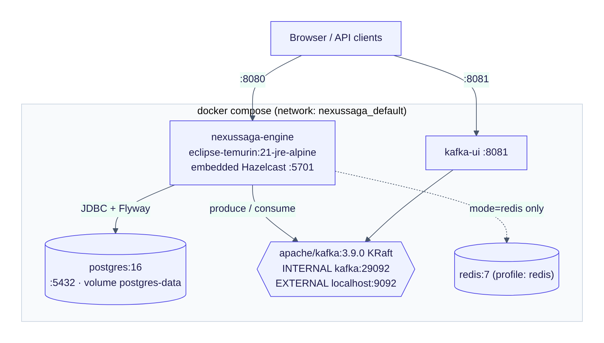

# 1. Deployment topology



| Service | Image | Port(s) | Purpose |
|---|---|---|---|
| `nexussaga-engine` | built from `Dockerfile` (Temurin 21 JRE Alpine) | 8080 HTTP, 5701 Hazelcast | The engine |
| `postgres` | `postgres:16` | 5432 | State, outbox, audit, DLQ |
| `kafka` | `apache/kafka:3.9.0` (KRaft) | 9092 external, 29092 internal | Messaging |
| `kafka-ui` | `provectuslabs/kafka-ui` | 8081 | Topic and message browser |
| `redis` | `redis:7-alpine` (profile `redis`) | 6379 | Only for `provider.mode=redis` |

# 2. Getting started

## 2.1 Prerequisites

- Docker Desktop (or Docker Engine + Compose v2) with about 4 GB RAM assigned.
- For local development and tests: Java 21 and Maven 3.9+.

## 2.2 Start everything

```bash
docker compose up --build
```

The first build downloads all Maven dependencies inside the build container, which can take 10–20 minutes. This is a one-time cost; Docker caches the layer, and later builds take about a minute unless `pom.xml` changes. The engine is ready when its log shows `Started NexusSagaApplication`.

| URL | What |
|---|---|
| http://localhost:8080 | Live dashboard |
| http://localhost:8080/swagger-ui.html | API documentation |
| http://localhost:8081 | Kafka UI |
| http://localhost:8080/actuator/health | Health (liveness and readiness groups) |
| http://localhost:8080/actuator/prometheus | Prometheus metrics |

## 2.3 Other ways to run

```bash
# Infrastructure in Docker, engine from Maven or your IDE
docker compose up -d postgres kafka
mvn spring-boot:run

# Redis provider
NEXUSSAGA_PROVIDER_MODE=redis docker compose --profile redis up --build

# Stop; add -v to delete the database and Kafka volumes
docker compose down
```

## 2.4 Multi-node (Hazelcast cluster)

Run several engine instances and list them in `HAZELCAST_MEMBERS` (for example `engine-1:5701,engine-2:5701,engine-3:5701`). The nodes form one embedded Hazelcast cluster, share locks, idempotency keys and snapshots, and join the same Kafka consumer group. Put a load balancer in front of port 8080.

# 3. Configuration reference

| Property | Env variable | Default | Description |
|---|---|---|---|
| `nexussaga.provider.mode` | `NEXUSSAGA_PROVIDER_MODE` | `hazelcast` | `hazelcast`, `redis` or `memory` |
| `nexussaga.provider.idempotency-ttl` | | `24h` | How long reply keys are remembered |
| `nexussaga.provider.state-cache-ttl` | | `1h` | Saga snapshot TTL |
| `nexussaga.provider.lock-wait` | | `3s` | Max wait for a saga lock |
| `nexussaga.provider.lock-lease` | | `30s` | Hazelcast lock lease |
| `nexussaga.hazelcast.members` | `HAZELCAST_MEMBERS` | `127.0.0.1` | TCP/IP member list |
| `nexussaga.redis.address` | `REDIS_ADDRESS` | `redis://localhost:6379` | Redis URL |
| `nexussaga.security.hmac-secret` | `NEXUSSAGA_HMAC_SECRET` | dev value | Bootstrap tenant secret and receipt signing key |
| `nexussaga.security.aes-key` | `NEXUSSAGA_AES_KEY` | dev value | Base64 32-byte AES key |
| `nexussaga.security.require-timestamp` | | `true` | Timestamp + replay protection |
| `nexussaga.security.max-clock-skew` | | `5m` | Accepted clock difference |
| `nexussaga.security.bootstrap-tenant.api-key` | `NEXUSSAGA_BOOTSTRAP_API_KEY` | dev value | API key of the first tenant |
| `nexussaga.reaper.check-interval-ms` | | `5000` | Zombie reaper period |
| `nexussaga.outbox.poll-interval-ms` | | `250` | Relay poll period |
| `nexussaga.outbox.max-attempts` | | `10` | Send attempts before `FAILED` |
| `nexussaga.kafka.reply-topic` | | `nexussaga.step.replies` | Unified reply topic |
| `nexussaga.kafka.partitions` | | `6` | Partitions of created topics |
| `nexussaga.demo.enabled` | `NEXUSSAGA_DEMO_ENABLED` | `true` | Chaos endpoints and mock participants |
| `nexussaga.demo.duplicate-reply-rate` | | `0.35` | Simulated redelivery rate |
| `spring.datasource.url` | `DB_URL` | `jdbc:postgresql://localhost:5432/nexussaga` | Database |
| `spring.kafka.bootstrap-servers` | `KAFKA_BOOTSTRAP_SERVERS` | `localhost:9092` | Kafka |

# 4. Monitoring

## 4.1 Key metrics

| Prometheus metric | Meaning | Alert idea |
|---|---|---|
| `nexussaga_events_total` | Replies processed | Rate drops to 0 while sagas are active |
| `nexussaga_db_queries_saved` | Reads avoided by the shield | — |
| `nexussaga_db_savings_percent` | Share of events served from memory | Sudden drop after a deploy |
| `nexussaga_db_sql_statements` | SQL statements issued | Unexpected growth |
| `nexussaga_rollbacks_total` | Compensations started | Spike vs. baseline |
| `nexussaga_sagas_dlq` | Sagas dead-lettered | Any increase |

## 4.2 Useful SQL

```sql
-- Sagas per status
SELECT status, count(*) FROM saga_instances GROUP BY status;

-- Stuck outbox rows
SELECT id, topic, attempts, last_error FROM outbox_events WHERE status <> 'PUBLISHED' ORDER BY id;

-- Pending DLQ
SELECT saga_id, failed_step_name, reason, created_at FROM saga_dlq WHERE status = 'PENDING';

-- Audit trail of one saga
SELECT seq, event_time, event_type, step_name, status FROM saga_audit_log
WHERE saga_id = '<id>' ORDER BY seq;
```

Run these with `docker exec -it nexussaga-postgres-1 psql -U nexussaga -c "<sql>"`.

# 5. Operational runbooks

## 5.1 A saga is in the DLQ

1. `GET /api/v1/dlq` and read `reason` and `failedStepName`.
2. Fix the cause (the participant is down, a bug, or bad data).
3. **Replay** if the participant can now compensate: `POST /api/v1/dlq/{sagaId}/replay`.
4. **Force-complete** if you undid the effect manually: `POST /api/v1/dlq/{sagaId}/force-complete` with a note.
5. Download the audit receipt for the incident record.

## 5.2 Outbox rows stay `PENDING` or become `FAILED`

Kafka is unreachable or a topic is missing. Check broker health and `last_error`. After fixing, reset failed rows: `UPDATE outbox_events SET status='PENDING', attempts=0 WHERE status='FAILED';`.

## 5.3 Many sagas time out

A participant is slow or down, or `timeoutSeconds` is too low for its real latency. Check the participant's consumer lag in Kafka UI and raise `timeoutSeconds` by registering a new workflow version.

## 5.4 Rotating secrets

1. Insert a new tenant row (or update the encrypted secret) and give the client the new key and secret.
2. When all clients use the new credentials, deactivate the old row (`active = false`).
3. Rotating `aes-key` requires re-encrypting stored payloads; plan it as a migration.

# 6. Troubleshooting

| Symptom | Cause | Fix |
|---|---|---|
| `docker compose up --build` stuck on `dependency:go-offline` for many minutes | First-time download of all Maven dependencies inside the container | Wait; it is cached afterwards. Check progress with `docker stats` |
| Port already in use | Another program uses 8080, 5432, 9092 or 8081 | Stop it or change the host port in `docker-compose.yml` |
| Dashboard unstyled, status "connecting…" | Browser cannot reach the CDNs (Tailwind, SockJS, STOMP) | Allow internet access from the browser |
| `401 payload may have been tampered with` with your own client | The body sent differs from the body signed (extra space or newline, re-serialised JSON) | Sign and send the identical byte string. In zsh use `--data-raw "$BODY"` |
| zsh: `command not found: #` | zsh does not treat `#` as a comment interactively | Run `setopt interactive_comments` |
| `401 Replayed request rejected` | Same timestamp and body sent twice | Use a fresh millisecond timestamp per request |
| `401 Missing or expired X-Timestamp` | Client clock off by more than 5 minutes, or seconds/ms confusion | Sync the clock (NTP) |
| Saga stays `IN_PROGRESS` then `FAILED` with "timed out" | No participant consumes the step topic | Start the participant or check its topic names |
| Hazelcast warning about Java modules | Missing `--add-opens` flags | Already set in the Dockerfile and Maven plugins |
| Testcontainers: "client version 1.32 is too old" | Docker Engine 29 with an old Testcontainers | Project uses Testcontainers 1.21.4 |

# 7. Testing

## 7.1 Automated tests

```bash
mvn clean verify
```

| Suite | Count | Covers |
|---|---|---|
| `SagaOrchestratorTest` | 21 | Start, forward path, retries, reverse traversal order, step-0 failure, DLQ, duplicate/stale shielding, timeouts, tenant checks |
| Provider tests (Hazelcast, Redis, Caffeine) | 25 | Locks, idempotency TTL, snapshots, lease expiry (real embedded Hazelcast member) |
| `HmacAndApiKeyAuthFilterTest` | 12 | Valid, tampered, wrong secret, stale timestamps, replay, body-only mode, size limit |
| `AesGcmPayloadEncryptorTest` | 8 | Round trip, random IV, nested and non-text fields, tamper and wrong-key detection |
| Audit, reaper, DLQ, registry, relay, controllers and others | 63 | Hash chain, tamper detection, leader lock, paging, replay, validation |
| `NexusSagaIntegrationTest` | 1 | Real PostgreSQL and Kafka via Testcontainers: 3-step workflow, step 3 fails, compensation order step 2 → step 1, FAILED, encrypted PII, outbox relayed, signed receipt valid |

**Coverage (JaCoCo, unit and integration combined):** 90.6 % branch, 95.5 % line, 96.7 % instruction. The report is at `target/site/jacoco/index.html`.

## 7.2 Manual acceptance checklist

| # | Test | Expected |
|---|---|---|
| 1 | Dashboard shows "● live" | WebSocket connected |
| 2 | Run Happy Path | All steps green, `COMPLETED` |
| 3 | Step-3 Crash | 3 failed attempts, then charge-payment and reserve-inventory compensated in that order, `FAILED` |
| 4 | Network Hang | After about 10–15 s `TIMED_OUT`, rollback, `FAILED` |
| 5 | Download Audit Receipt | `chainVerified: true`, PII `****`, microsecond timestamps |
| 6 | `psql` on `saga_instances.payload` | Card, email and address are `enc:v1:…` |
| 7 | Unsigned `curl /api/v1/metrics/db-savings` | `401` |
| 8 | Signed request | `200` with metrics |
| 9 | Same signed request again | `401 Replayed request rejected` |
| 10 | Modify one `saga_audit_log` row, download the receipt again | `chainVerified: false`, `firstInvalidSeq` set |
| 11 | Start a saga on an unconsumed workflow | Times out, compensation times out, saga lands in the DLQ |
| 12 | DLQ replay / force-complete | `DLQ_REPLAYED` / `DLQ_FORCE_COMPLETED` in the audit trail |

## 7.3 CI/CD

`.github/workflows/ci.yml` runs on every push and pull request, in three jobs:

| Job | Steps |
|---|---|
| Build · unit tests · integration test | JDK 21 with Maven cache → `mvn clean verify` (129 unit tests + Testcontainers integration test) → test and coverage summary on the run page → reports and jar uploaded as artifacts |
| Docker image · compose stack · smoke test | `docker compose up -d --build --wait` → `scripts/smoke-test.sh` (19 checks: health, auth rejection, tampering, signed API, workflow registration, all three chaos scenarios, compensation order, audit chain, masking, encryption at rest, metrics) → engine logs on failure → `docker compose down -v` |
| Documentation PDFs | Rebuilds all PDFs from `docs/*.md` and uploads them with the diagrams |

The smoke test also runs locally against any running stack: `./scripts/smoke-test.sh`.

# 8. Project structure

```text
nexussaga/
├── pom.xml · Dockerfile · docker-compose.yml · README.md
├── .github/workflows/ci.yml
├── docs/                      ← these documents, diagram sources, images, PDFs
├── src/main/java/com/nexussaga/
│   ├── api/  audit/  chaos/  config/  domain/  engine/
│   ├── messaging/  metrics/  provider/  realtime/  repository/  security/
├── src/main/resources/
│   ├── application.yml
│   ├── db/migration/V1__init_nexussaga.sql
│   └── static/index.html      ← live dashboard
└── src/test/java/com/nexussaga/   ← unit + integration tests
```
